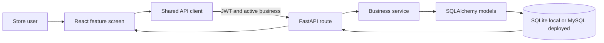

# DG-Retail OS

DG-Retail OS is a retail operations application for mobile and electronics stores. It combines a React-based point-of-sale interface with a FastAPI backend and SQLAlchemy persistence. The workflows cover day-to-day billing, inventory, customer and supplier accounts, store-financed EMI, cash management, and operational reports.

## Contents

- [Features](#features)
- [How the App Fits Together](#how-the-app-fits-together)
- [Core Workflows](#core-workflows)
- [Roles and Access](#roles-and-access)
- [Technology](#technology)
- [Run Locally](#run-locally)
- [Demo Accounts](#demo-accounts)
- [Configuration](#configuration)
- [Project Structure](#project-structure)
- [API and Data](#api-and-data)
- [Tests and Build](#tests-and-build)
- [Deployment Notes](#deployment-notes)
- [Known Limitations](#known-limitations)

## Features

- **Dashboard and access control:** business overview, role-aware navigation, JWT authentication, staff roles, and business switching.
- **Point of sale:** product, barcode, and IMEI lookup; cart checkout; split and credit payments; GST calculations; invoice printing and PDF download; checkout retry protection.
- **Inventory:** product categories and catalogue, stock tracking, serialized-device/IMEI tracking, and inventory lookup.
- **Sales and customer accounts:** sale history, customer profiles and ledgers, payment collection, and WhatsApp reminder links.
- **Purchasing and suppliers:** purchase entry, supplier profiles and ledgers, and supplier payments.
- **EMI:** store-financed plans, installment schedules, collections, and reminder links.
- **Store finance:** expense tracking, cash/bank accounts, and cash reconciliation.
- **Specialized workflows:** device exchanges, warranty records, and repair tickets.
- **Reports and administration:** sales, profit-and-loss, GST and stock-valuation reports; CSV/PDF/XLSX exports; audit logs, notifications, and owner data export.

Some workflows are partial; see [Known Limitations](#known-limitations) and the detailed [feature audit](docs/FEATURE_AUDIT_REPORT.md).

## How the App Fits Together

The frontend is the operator workspace; the backend is the authority for business rules and persisted records. A screen calls the shared API client, which sends requests to the `/api/v1` API with the user's JWT and active-business context. FastAPI routes authenticate and authorize the request, then use services and SQLAlchemy models to validate and save the business transaction. The API response updates the screen.



The main business records are scoped to a store/business. An owner can switch between available stores; the selected store is sent with API calls, and the backend scopes data access to the authenticated user and active business. The frontend uses the role to show the relevant modules, while backend routes also apply role checks to protected operations.

## Core Workflows

### 1. Set up a store and its catalogue

1. Sign in and select the active store if the account has access to multiple stores.
2. Add product categories and products, including selling price, cost, GST/HSN details, stock level, warranty period, and whether the product is serialized.
3. Add suppliers and configure the store's accounts and expense categories.
4. For demo data, a fresh development database is seeded automatically. Existing data is preserved; startup does not reset or reseed it.

### 2. Receive a purchase and add stock

1. An owner or manager records a supplier invoice and selects the received products.
2. For serialized devices, enter exactly one IMEI/serial value for each unit received. The backend checks the request and rejects identifiers already registered for the store.
3. On save, the purchase is recorded, stock quantity is increased, each device is registered as `IN_STOCK`, and a purchase stock movement is created.
4. The supplier balance is updated for the unpaid amount. Any amount paid is recorded against the selected payment method and deducted from the matching cash/bank account when available.

### 3. Sell an item at the POS

1. Find an item by product, SKU/barcode, or IMEI/serial and add it to the bill. A serialized device must be selected by its own identifier; it cannot be sold as an untracked quantity.
2. Add or select the customer when needed, then choose full payment, split payment, customer credit, or store-financed EMI. A customer phone number is required for an EMI sale.
3. The server rechecks product availability, serialized-device status, price, tax, discount permissions, payment totals, and EMI inputs. The browser is not trusted to determine final prices or stock.
4. Checkout creates the sale and invoice and, within the same database transaction, records sale items and payments, decrements stock, marks serials sold, records stock movements, updates the customer ledger and account balances, creates warranty records, and writes an audit entry. If selected, it also records an exchange device or creates an EMI plan and installment schedule.
5. Print the receipt, download the invoice PDF, or share the invoice link. A retry carrying the same checkout idempotency key returns the existing sale instead of intentionally creating another one.

### 4. Collect a customer balance or EMI installment

1. Use the customer ledger to review a balance and enter a payment against the customer account, or open an EMI plan to collect against an installment.
2. Customer payments add a credit to the ledger and increase the associated cash/bank balance. Overpayment is retained as a negative customer balance (an advance).
3. EMI collections are recorded as payments, applied to the selected installment or the oldest open installment, and update the installment and plan balances. The collection also updates the customer ledger and the associated account when one is available.
4. Reminder actions open WhatsApp share links; the application does not send messages through a configured messaging provider.

### 5. Record expenses and review the day

1. Record an expense with its category, date, amount, and payment method. The amount is deducted from the matching cash/bank account when available.
2. At close, compare the expected cash summary with the physical cash count and submit a cash reconciliation.
3. Owners, managers, and accountants can review sales, profit-and-loss, GST, and stock valuation reports, filter supported reports, and export available reports.

### 6. Handle returns, repairs, and exchanges

Return intake currently records an item for inspection. Do not treat it as a completed refund: approval, refund payment, stock restoration, customer-ledger adjustment, and return-aware reporting are not yet a complete workflow. Repair tickets and exchange records support operational tracking, but repair parts/service billing and full exchange inventory/accounting integration are also outstanding.

## Roles and Access

These are the modules shown in the frontend for each role. Individual API operations have their own backend authorization checks; use the app's actual permissions as the authority for a specific action.

| Role | Typical access |
|---|---|
| Owner | All modules, store/business administration, staff, settings, reports, and data export. |
| Manager | Dashboard, POS, sales, inventory, customers, EMI, purchases, suppliers, finance, specialized workflows, and reports. |
| Sales staff | Dashboard, POS, sales, inventory, customers, EMI, exchange, repairs, and warranty. |
| Accountant | Dashboard, sales, customers, EMI, suppliers, cash/bank, expenses, and reports. |

## Technology

- **Frontend:** React 19, Vite 5, Tailwind CSS, Recharts, and Lucide icons.
- **Backend:** Python, FastAPI, Pydantic settings, SQLAlchemy 2, and Uvicorn.
- **Database:** SQLite for local development by default; MySQL is expected for staging and production.
- **Tests:** pytest with an in-memory SQLite database for core business logic.

## Run Locally

### Prerequisites

- Python 3.10 or newer.
- Node.js 18 or newer and npm.

### 1. Install backend dependencies

From the repository root, create a virtual environment and install the backend requirements:

```powershell
py -m venv .venv
.\.venv\Scripts\python.exe -m pip install -r backend\requirements.txt
```

On macOS or Linux, use `python3 -m venv .venv` and `.venv/bin/python -m pip install -r backend/requirements.txt`.

### 2. Start the API

Run from the repository root:

```powershell
.\.venv\Scripts\python.exe backend\run_server.py
```

The server selects an available port starting at `8000` and writes it to `backend/.server-port`. In development, the database defaults to SQLite at `backend/dg_retail.db`; the schema is created at startup and seed data is added when the database is empty. Keep this terminal running.

API documentation is available at `http://127.0.0.1:8000/docs` when the server uses port 8000. The health endpoint is `/api/health`. If the port finder selects a different port, use that port instead.

### 3. Start the frontend

In a second terminal:

```powershell
cd frontend
npm ci
npm run dev
```

Open the local URL printed by Vite, normally `http://localhost:5173`. The Vite development server proxies `/api` requests to the backend port recorded in `backend/.server-port`. Start the backend before the frontend so the proxy can discover its port.

## Demo Accounts

On a newly seeded development database, sign in with one of these accounts:

| Role | Username | Password |
|---|---|---|
| Owner | `rajesh` | `rajesh123` |
| Manager | `suresh` | `suresh123` |
| Sales staff | `amit` | `amit123` |
| Accountant | `pooja` | `pooja123` |

These are development-only credentials defined by the seed data. Do not use them outside a local demo. Existing databases are not reseeded or overwritten at startup.

## Configuration

The backend reads environment variables and a `.env` file from its current working directory. The local run command above starts it from the repository root. Copy `.env.example` to `.env` in the repository root for backend settings such as `DATABASE_URL` and `SECRET_KEY`; do not commit secrets. Vite is started from `frontend`, so frontend-only values such as `VITE_API_URL` should be set in `frontend/.env` or in the environment that launches Vite.

| Variable | Purpose | Default / guidance |
|---|---|---|
| `ENVIRONMENT` | Runtime mode | `development` |
| `DATABASE_URL` | SQLAlchemy database connection | Defaults to the backend SQLite file in development. Staging/production require MySQL. |
| `SECRET_KEY` | JWT signing key | Generated and saved locally in development; must be set explicitly for production. |
| `SEED_DATABASE` | Seed a staging database when enabled | `false`; development seeds automatically only when no business data exists. |
| `BACKEND_CORS_ORIGINS` | Trusted frontend origins | Defaults to local Vite origins; provide a comma-separated list in deployment. |
| `VITE_API_URL` | Frontend API base URL | Local development defaults to the Vite `/api/v1` proxy. For a separately hosted frontend, set this in `frontend/.env` to the full API base URL. |
| `DEFAULT_CURRENCY` | Business default currency | `INR` |
| `DEFAULT_GST_RATE` | Business default GST rate | `18.0` |

The example environment file contains a MySQL URL template. MySQL must be installed and reachable before using that URL. For a zero-configuration local run, leave `DATABASE_URL` unset and use the SQLite default.

## Project Structure

```text
backend/
	app/
		models/       SQLAlchemy entities
		routers/      FastAPI route modules
		schemas/      Request and response models
		services/     POS, EMI, accounting, and messaging logic
		utils/        Shared backend utilities
	migrations/     Reviewed SQL migrations
	tests/          Backend test suite
	run_server.py   Development API launcher with port selection
frontend/
	src/
		api/          API client
		components/   Authenticated views grouped by feature
		context/      Application state and access control
	vite.config.js  Dev server and API proxy configuration
docs/             Feature audit and gap analysis
```

## API and Data

- API prefix: `/api/v1`.
- Interactive OpenAPI documentation: `/docs` (development server).
- Health check: `/api/health`.
- API areas include authentication, dashboard, inventory, POS, customers, EMI, purchases, suppliers, finance, specialized device workflows, reports, and settings.
- Local development creates tables from SQLAlchemy models and applies a small additive compatibility check. Production schema changes must use reviewed migrations from `backend/migrations/`; production startup does not create the schema automatically.
- The sale idempotency migration is `backend/migrations/001_add_sale_idempotency.sql`.

## Tests and Build

Run the backend tests from the `backend` directory:

```powershell
..\.venv\Scripts\python.exe -m pytest -q
```

Create a production frontend build from the `frontend` directory:

```powershell
npm run build
```

To serve the built frontend locally, run `npm run preview` from `frontend`.

## Deployment Notes

- Use MySQL for staging and production; SQLite is rejected in those environments.
- Set a strong `SECRET_KEY` through a secret manager and configure `DATABASE_URL` and exact `BACKEND_CORS_ORIGINS` values.
- Set `ENVIRONMENT=production` and keep `SEED_DATABASE=false` in production.
- Apply reviewed SQL migrations as part of deployment. Production startup intentionally does not mutate the schema.
- Build and host the frontend separately or behind a web server; configure `VITE_API_URL` to the deployed API base URL, including `/api/v1`.
- The app handles retail records and customer data. Apply appropriate access controls, backups, retention policies, and operational monitoring in any real deployment.

## Known Limitations

- Returns can be recorded for inspection, but the complete approved refund, stock-restoration, customer-ledger, and report-adjustment workflow is not implemented.
- The backup endpoint exports business-scoped JSON data, but a restore workflow is not implemented.
- Several collection and purchase workflows still need idempotency and stronger concurrency coverage; MySQL concurrency behavior requires integration verification.
- Payment account mapping is simplified for some methods, and complete purchase-return, inventory-adjustment, and repair-service billing workflows are not available.
- WhatsApp actions create share/reminder links; they are not a configured message-delivery service. Tax summaries are reports, not electronic tax filing.

See [Feature Audit Report](docs/FEATURE_AUDIT_REPORT.md) for verified behavior and [Feature Gap Analysis](docs/FEATURE_GAP_ANALYSIS.md) for a fuller status matrix.
